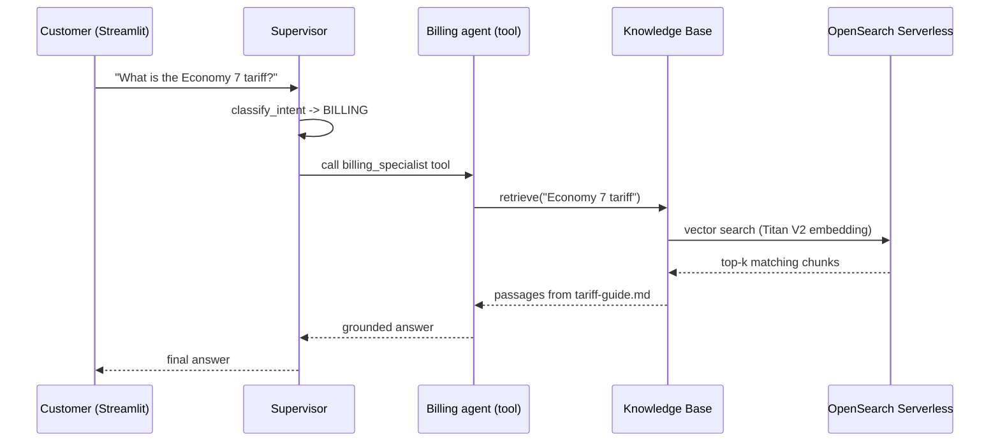

# Multi-Agent Customer Service Platform — Architecture Guide

> A public AWS sample. The scenario — **AnyCompany Energy**, a fictional UK
> utility — is illustrative only; all names and data are synthetic.

This document describes the system architecture, the agents-as-tools multi-agent
pattern, the request and RAG data flows, the security model, and the cost/ROI
business case.

---

## 1. System Overview

AnyCompany Energy fields roughly **12,000 customer interactions per month** at a
fully-loaded handling cost of **GBP 8.50 per interaction**. The objective of this
sample is to demonstrate an **agentic AI system** that automates the end-to-end
service journey — service triage → billing → scheduling → escalation — and that
can credibly remove **40–60%** of that handling cost.

The system is built with the **Strands Agents SDK** on **Amazon Bedrock**, using
the **agents-as-tools** multi-agent pattern. A single supervisor agent (the
*Intent Router*) classifies each customer query and routes it to one of three
specialist agents, each of which is itself a Strands `Agent` exposed to the
supervisor as a callable tool. A **Bedrock Knowledge Base** (Amazon S3 + Amazon
OpenSearch Serverless) provides Retrieval-Augmented Generation (RAG) for the
billing and escalation specialists. A **Streamlit** app runs the agents in process
and renders a live routing/tool timeline from the Strands callback stream.

Because the orchestration is plain Python on Strands (not the Bedrock Agents
classic multi-agent collaboration API), the exact same code runs locally and
deploys to **Amazon Bedrock AgentCore Runtime** for production scale.

Agents use a **tiered foundation-model strategy**:

- **Supervisor / intent router** — **Anthropic Claude Opus 4.6**
  (`anthropic.claude-opus-4-6-v1`), for the strongest routing/multi-intent
  reasoning at the front door.
- **Specialist agents** (billing, scheduling, escalation) — **Anthropic Claude
  Sonnet 4.6** (`anthropic.claude-sonnet-4-6`), for fast, cost-efficient tool
  execution within a narrow scope.

Both Claude 4.6 models are invoked via **cross-region inference profiles**
(`us.anthropic.*` / `eu.anthropic.*`) because Claude 4.x cannot be invoked
on-demand by bare model id. The geo prefix is auto-detected from the deploy
region (`agents/config.py`). The Knowledge Base uses **Amazon Titan Text
Embeddings V2**.

---

## 2. Architecture Diagram

![Architecture: a serverless multi-agent customer-service platform on Amazon Bedrock. A Streamlit in-process demo sends the user query to a Supervisor / intent router agent running on Amazon Bedrock AgentCore Runtime, which routes to Billing, Scheduling, or Escalation specialist agents. Billing and Escalation ground answers via a Bedrock Knowledge Base (Amazon S3 policy docs ingested and embedded with Titan V2 into Amazon OpenSearch Serverless). Escalation hands off to Amazon Connect. A Bedrock Guardrail intercepts every model call and emits metrics to Amazon CloudWatch.](./architecture.png)

*Editable source: [`architecture.drawio`](./architecture.drawio) — open with [draw.io](https://www.drawio.com/).*

**Numbered flow (matches the badges in the diagram):**

1. A customer query enters through the **Streamlit demo** (which runs the agents in process) and reaches the **Supervisor / intent router**.
2. The supervisor classifies intent (deterministic keyword scorer, **0.34** threshold) and **routes to one specialist** — billing, scheduling, or escalation.
3. The **billing** and **escalation** specialists ground answers via the **Bedrock Knowledge Base** (`retrieve`): Amazon S3 policy docs are ingested and embedded with **Titan Text Embeddings V2** into **OpenSearch Serverless** for vector search. *(Scheduling is stateless — no retrieval.)*
4. The **escalation** specialist opens a ticket and hands off to **Amazon Connect** (human queue).
5. A **Bedrock Guardrail** intercepts **every** model call; agent and guardrail metrics flow to **Amazon CloudWatch**.

The logical component view below details the agents-as-tools wiring and the mock datastore seam:

```mermaid
flowchart TB
    subgraph Client["Demo / Runtime"]
        UI["Streamlit demo (demo/app.py)<br/>runs agents in process<br/>+ live timeline from Strands callbacks"]
    end

    subgraph App["Strands Agents app (agents/)"]
        SUP["Supervisor / intent router<br/>Claude Opus 4.6<br/>tools: classify_intent + 3 specialists"]

        subgraph Specialists["Specialist agents (as tools)"]
            BILL["Billing agent<br/>Claude Sonnet 4.6<br/>lookup_account, check_balance, retrieve"]
            SCHED["Scheduling agent<br/>Claude Sonnet 4.6<br/>check_availability, book_appointment, cancel_appointment"]
            ESC["Escalation agent<br/>Claude Sonnet 4.6<br/>create_ticket, transfer_to_agent, retrieve"]
        end

        DATA["mock_data.py<br/>(deterministic datastore)"]
    end

    subgraph KB["Knowledge Base (RAG)"]
        BKB["Bedrock Knowledge Base"]
        OSS["OpenSearch Serverless<br/>Vector Index (Titan V2)"]
        S3["S3: KnowledgeBaseDocsBucket<br/>billing-faqs / tariff-guide /<br/>policies / service-procedures"]
    end

    GUARD["Bedrock Guardrail<br/>(applied on every model call)"]

    UI -->|supervisor(query) / stream_async| SUP
    SUP -->|classify_intent| SUP
    SUP -->|billing_specialist tool| BILL
    SUP -->|scheduling_specialist tool| SCHED
    SUP -->|escalation_specialist tool| ESC

    BILL -->|retrieve| BKB
    ESC -->|retrieve| BKB
    BKB --> OSS
    S3 -->|sync / ingestion| OSS

    BILL -.-> DATA
    SCHED -.-> DATA
    ESC -.-> DATA

    GUARD -.-> SUP & BILL & SCHED & ESC
```

---

## 3. Components

### 3.1 Supervisor — Intent Router (`agents/supervisor.py`)
- A Strands `Agent` (Claude Opus 4.6) whose tools are `classify_intent` plus the
  three specialist agents wrapped as tools (`billing_specialist`,
  `scheduling_specialist`, `escalation_specialist`).
- `classify_intent` (`agents/intent.py`) uses a deterministic keyword/heuristic
  scorer across BILLING / SCHEDULING / ESCALATION and returns
  `{intent, confidence, recommended_agent, reasoning}`. A normalised top score
  below **0.34** yields UNKNOWN, and the supervisor asks a clarifying question.
- The supervisor routes by **calling the matching specialist tool** and
  synthesises the specialists' output into one customer-facing reply.

### 3.2 Billing agent (`agents/specialists.py`) — RAG-enabled
- Tools: `lookup_account(account_number)` (profile), `check_balance(account_number)`
  (`balance_gbp`, `due_date`, `last_payment`, `status`), and `retrieve` (RAG).
- Uses the Knowledge Base (via `retrieve`) for tariff/policy/billing questions.

### 3.3 Scheduling agent (`agents/specialists.py`)
- Tools: `check_availability(appointment_type, postcode, preferred_date?)`,
  `book_appointment(account_number, slot_id, contact_phone)` (`APPT-######`),
  `cancel_appointment(booking_reference)`. `appointment_type` ∈ {`METER_READING`,
  `ENGINEER_VISIT`, `LEAK_INVESTIGATION`, `EV_CHARGER_INSTALL`}.

### 3.4 Escalation agent (`agents/specialists.py`) — RAG-enabled
- Tools: `create_ticket(account_number, issue_summary, category, priority?)`
  (`TKT-######`; category/priority → `sla_hours`, with VULNERABILITY/CRITICAL → 2,
  HIGH → 8, MEDIUM → 24, LOW → 72), `transfer_to_agent(ticket_id, reason,
  account_number?)` (simulated **Amazon Connect** handoff, queue/team inferred
  from the reason, `connect_contact_id` `CT-` + 8 hex), and `retrieve` (RAG) for
  authoritative redress-scheme contacts (Energy Ombudsman / CCW).

### 3.5 Tools & datastore (`agents/tools.py`, `agents/mock_data.py`)
The `@tool` functions are plain Python (no Lambda packaging) that delegate to the
deterministic in-memory datastore in `agents/mock_data.py`. Slot ids, booking
references, ticket ids and transfer ids are derived deterministically so the
`testing-guide.md` scenarios reproduce the same *shapes* every run.
`mock_data.py` is the integration seam that the `tools.py` `@tool` functions
delegate to, so replacing it with real CRM/billing/scheduling clients (and
enforcing account-scoped authorization there — see the top-level README
"Production hardening") is the single, intended swap point for a production build.

### 3.6 Guardrail (`agents/config.py` + CDK)
The Bedrock Guardrail is provisioned by the CDK stack and applied on **every**
model invocation via the Strands `BedrockModel` (`guardrail_id` /
`guardrail_version`) — content filters, `FINANCIAL_ADVICE` denied topic, PII
ANONYMIZE (phone/email/card/sort-code) and prompt-attack detection. Contextual
grounding filters are configured at 0.7 but not evaluated, because the requests
carry no tagged grounding source, and guardrails on Converse don't evaluate tool
results (see the top-level README "What the guardrail doesn't cover"). Soft,
context-dependent behavior (competitors, other customers' data) is **instructed**
via the agent system prompts — a
behavioral instruction, not enforcement. Account-scoped authorization must be
enforced deterministically at the tool/IAM layer in production (see the top-level
README "Production hardening").

### 3.7 Knowledge Base + storage (CDK)
- **S3 bucket** holds the four markdown documents (deployed via
  `BucketDeployment`).
- **Bedrock Knowledge Base** chunks (fixed-size 500 tokens / 20% overlap) and
  embeds them with **Titan V2** into an **OpenSearch Serverless** vector index
  (provisioned by `cdklabs.generative-ai-cdk-constructs`).
- A **sync** (ingestion) is run after deploy to populate the index (console →
  Knowledge Base → data source → **Sync**).

### 3.8 Runtime
- **Demo:** `demo/app.py` imports `agents.supervisor.build_supervisor`, runs the
  supervisor in process, and uses a shared Strands **callback handler** to render
  the per-turn routing/tool timeline.
- **Production:** the same supervisor deploys to **Amazon Bedrock AgentCore
  Runtime** via a thin `@app.entrypoint` wrapper (see the README "Production
  deployment").

---

## 4. Request Flow (agents as tools)

1. The customer types a message. The demo calls `supervisor(message)` (or
   `supervisor.stream_async(message)` for streaming).
2. The supervisor calls `classify_intent` to get an explicit intent + confidence
   + reasoning.
3. The supervisor **calls the matching specialist tool** (e.g.
   `billing_specialist`). Internally that invokes the specialist `Agent`, which
   runs its own tool loop (e.g. `check_balance`, or `retrieve` for RAG).
4. The specialist returns its answer to the supervisor as the tool result.
5. The supervisor synthesises the final customer-facing reply.
6. The Strands callback handler captures the whole nested timeline (classify →
   route → specialist tool calls + results), which the Streamlit sidebar renders.

For low-confidence/UNKNOWN input the supervisor does not route and instead asks a
clarifying question.

---

## 5. RAG Data Flow (billing/tariff question)



**Ingestion (one-time / on document change):** S3 documents → Knowledge Base
**Sync** → Bedrock chunks each markdown file → Titan V2 embeds each chunk →
vectors written to the OpenSearch Serverless index. At query time the `retrieve`
tool fetches the most relevant chunks and the specialist grounds its answer in
them, reducing hallucination.

---

## 6. Security Model

- **Guardrail on every call.** The Strands `BedrockModel` applies the Bedrock
  Guardrail to every supervisor/specialist invocation — this enforces content and
  PII policies on model input and output, and prompt-attack detection on input.
  It doesn't
  evaluate tool results, so retrieved knowledge-base text isn't screened, and
  contextual grounding isn't evaluated.
- **Account scoping is instructed, not enforced.** The system prompts instruct
  the agents to act only on the authenticated account and not recommend
  competitors, but a system prompt is a behavioral instruction, not a security
  control — it does not enforce authorization. The sample tools return data for
  whatever `account_id` they receive. In production, enforce account-scoped access
  at the tool/IAM layer: pass the authenticated account identity as trusted
  context (not as a model-supplied parameter) and reject any tool call that
  references a different account.
- **Prompt-injection surface.** The agents-as-tools pattern forwards free-text
  customer input into nested specialist agent loops, which is an inherent
  prompt-injection surface. It is mitigated by (a) the specialists' only tools
  being harmless in-memory mock data with no file/network/shell/exec sinks, and
  (b) the guardrail's prompt-attack filter, which screens customer input, not
  tool results such as retrieved knowledge-base text. **In production the
  guardrail must be enabled** (`GUARDRAIL_ID` set) — injection resistance relies
  on it.
- **IAM (runtime).** The principal running the agents needs
  `bedrock:InvokeModelWithResponseStream` / `bedrock:InvokeModel` on the
  inference profiles, `bedrock:ApplyGuardrail` on the guardrail, and
  `bedrock:Retrieve` on the Knowledge Base. On AgentCore Runtime these are granted
  to the runtime execution role.
- **Knowledge Base role (CDK).** A dedicated role grants the Knowledge Base read
  access to the S3 bucket and read/write to the OpenSearch Serverless collection;
  the OpenSearch data-access policy is scoped to that role.
- **S3 hardening.** The docs bucket blocks all public access, uses SSE-S3
  encryption, and (for easy demo teardown) `removal_policy = DESTROY` +
  `auto_delete_objects = True`.
- **No customer PII.** The datastore is in-memory and synthetic. A production
  deployment would replace it with an authenticated billing/CRM integration and
  add encryption in transit, KMS CMKs, audit logging and access controls.
- **Transport.** All service calls use AWS SigV4 over TLS.

---

## 7. Cost / ROI Business Case

| Metric | Value |
|---|---|
| Interactions per month | 12,000 |
| Cost per interaction (fully loaded) | GBP 8.50 |
| Current annual handling cost | 12,000 × 8.50 × 12 = **GBP 1,224,000** |
| Target automation / deflection | 40–60% |
| Projected annual saving | **GBP 489,600 – 734,400** |

The capstone targets a **40–60% cost reduction (~GBP 400–600K/year)**. The 40%
case (~GBP 490K/year) is the conservative planning figure; the 60% case
(~GBP 734K/year) is the stretch target once routing accuracy and tool coverage
mature.

**Where the savings come from:**
- **Tier-1 deflection** — balance lookups, tariff/policy questions and appointment
  booking are fully automated.
- **Faster handling** — agentic triage routes complex contacts to the right team
  immediately (Connect transfer), reducing transfers and handle time.
- **24/7 availability** — automated handling outside staffed hours.
- **Consistency & compliance** — RAG-grounded answers keep responses aligned with
  published tariffs and policies.

**Running cost (offsetting):** Bedrock model usage (Claude Opus 4.6 for routing +
Claude Sonnet 4.6 for the specialists + Titan embeddings), OpenSearch Serverless
OCUs, and S3 are small relative to the labour savings; the tiered model choice
keeps the bulk of token volume on the cheaper Sonnet tier while reserving Opus for
the single routing decision. On AgentCore Runtime, compute is billed for actual
agent execution. Even at the conservative 40% deflection the net benefit is
strongly positive.

---

## 8. Related Documents
- [docs/README.md](./README.md) — setup and deployment guide.
- [docs/testing-guide.md](./testing-guide.md) — test scenarios.
- [Top-level README](../README.md) — project overview.
