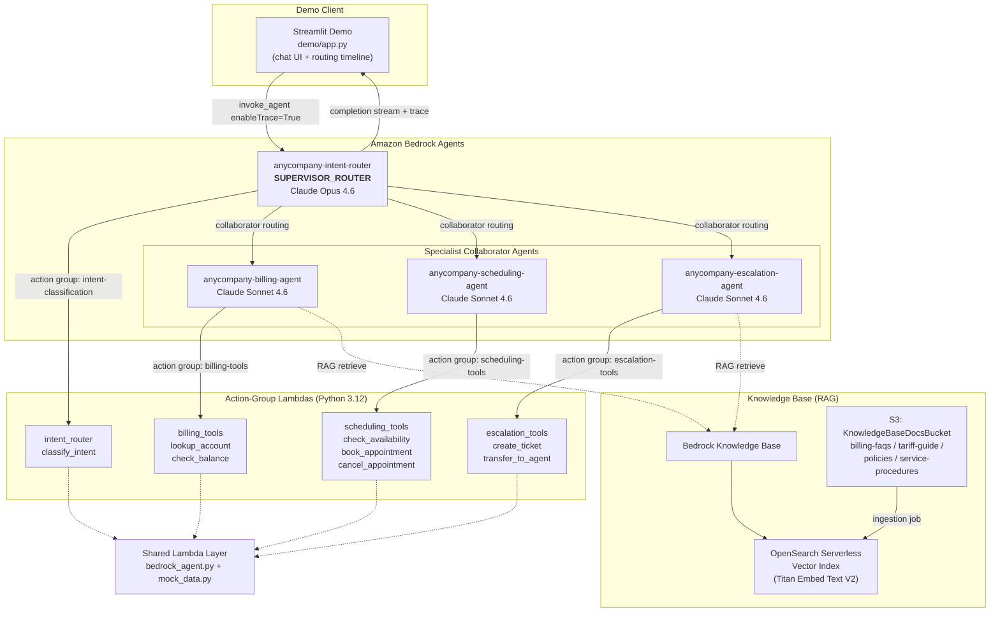
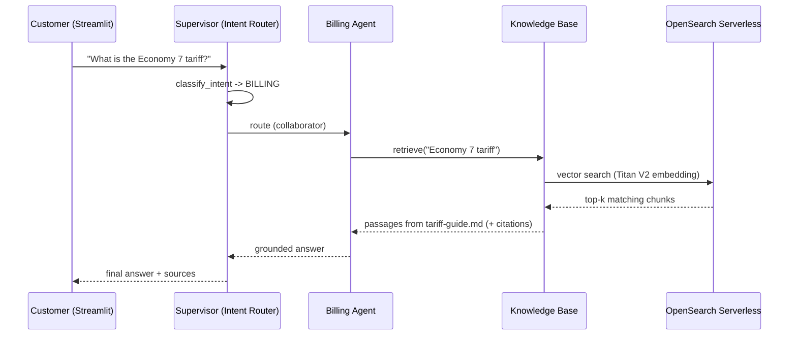

# Multi-Agent Customer Service Platform — Architecture Guide

> A public AWS sample. The scenario — **AnyCompany Energy**, a fictional UK
> utility — is illustrative only; all names and data are synthetic.

This document describes the system architecture, the multi-agent collaboration
pattern, the request and RAG data flows, the security/IAM model, and the
cost/ROI business case.

---

## 1. System Overview

AnyCompany Energy fields roughly **12,000 customer interactions per month** at a
fully-loaded handling cost of **GBP 8.50 per interaction**. The objective of
this sample is to demonstrate an **agentic AI system** that automates the
end-to-end service journey — service triage → billing → scheduling →
escalation — and that can credibly remove **40–60%** of that handling cost.

The system is built on **Amazon Bedrock Agents** using a **supervisor /
multi-agent collaboration** topology. A single supervisor agent (the *Intent
Router*) classifies each customer query and routes it to one of three
specialist collaborator agents, each backed by its own action-group Lambda. A
**Bedrock Knowledge Base** (backed by Amazon S3 and an Amazon OpenSearch
Serverless vector index) provides Retrieval-Augmented Generation (RAG) for the
Billing and Escalation agents so they can answer policy/tariff questions and
quote authoritative contact details grounded in AnyCompany's published documents.
A **Streamlit** application provides an interactive demo UI
that invokes the supervisor agent and renders a live routing/tool timeline.

Agents use a **tiered foundation-model strategy**:

- **Supervisor / intent router** — **Anthropic Claude Opus 4.6**
  (`anthropic.claude-opus-4-6-v1`), for the strongest routing and multi-intent
  reasoning at the front door, where classification quality drives every
  downstream decision.
- **Specialist agents** (billing, scheduling, escalation) — **Anthropic Claude
  Sonnet 4.6** (`anthropic.claude-sonnet-4-6`), for fast, cost-efficient tool
  execution within a narrow, well-defined scope.

Both Claude 4.6 models are invoked via **US cross-region inference profiles**
(`us.anthropic.claude-opus-4-6-v1` / `us.anthropic.claude-sonnet-4-6`) rather than
their bare model ids: Claude 4.x does not support on-demand invocation by bare id,
so the stack wraps each base model in a `CrossRegionInferenceProfile` (which also
provisions the matching cross-region `bedrock:InvokeModel` IAM grants).

The Knowledge Base uses **Amazon Titan Text Embeddings V2** for vectorisation.

---

## 2. Architecture Diagram

---

## 3. Components

### 3.1 Supervisor — Intent Router (`anycompany-intent-router`)
- Configured with `agentCollaboration = SUPERVISOR_ROUTER`.
- Owns the **`intent-classification`** action group, backed by the
  `lambdas/intent_router` Lambda. The `classify_intent(query)` function uses a
  deterministic keyword/heuristic scoring model across three intent categories
  (BILLING, SCHEDULING, ESCALATION) and returns
  `{intent, confidence, recommended_agent, reasoning}`. A normalised top score
  below `0.34` yields `UNKNOWN`.
- Has the three specialist agents attached as **collaborators**, each with a
  clear collaboration instruction describing when to route to it.
- The supervisor synthesises the final natural-language answer to the customer
  from the collaborator's response.

### 3.2 Billing agent (`anycompany-billing-agent`) — RAG-enabled
- Action group **`billing-tools`** → `lambdas/billing_tools`:
  - `lookup_account(account_number)` — returns account profile
    (name, tariff, status, postcode, on_payment_plan).
  - `check_balance(account_number)` — returns
    `{account_number, balance_gbp, due_date, last_payment, status}`.
- **Attached to the Knowledge Base** so it can answer tariff/policy/billing
  questions with grounded citations (RAG).

### 3.3 Scheduling agent (`anycompany-scheduling-agent`)
- Action group **`scheduling-tools`** → `lambdas/scheduling_tools`:
  - `check_availability(appointment_type, postcode, preferred_date?)` — returns
    a list of slots. `appointment_type` ∈
    {`METER_READING`, `ENGINEER_VISIT`, `LEAK_INVESTIGATION`, `EV_CHARGER_INSTALL`}.
  - `book_appointment(account_number, slot_id, contact_phone)` — returns a
    confirmed booking (`booking_reference` `APPT-######`).
  - `cancel_appointment(booking_reference)` — cancels a booking.

### 3.4 Escalation agent (`anycompany-escalation-agent`)
- Action group **`escalation-tools`** → `lambdas/escalation_tools`:
  - `create_ticket(account_number, issue_summary, category, priority?)` — opens
    a ticket (`ticket_id` `TKT-######`) and maps category/priority to
    `sla_hours` (VULNERABILITY/CRITICAL → 2, HIGH → 8, MEDIUM → 24, LOW → 72).
    `category` ∈ {`BILLING_DISPUTE`, `SUPPLY_ISSUE`, `COMPLAINT`,
    `VULNERABILITY`, `OTHER`}.
  - `transfer_to_agent(ticket_id, reason, account_number?)` — simulates an
    **Amazon Connect** handoff, inferring queue/team from the reason text and
    returning a `connect_contact_id` (`CT-` + 8 hex-ish chars).
- **Attached to the Knowledge Base** so it can quote authoritative redress-scheme
  contact details (Energy Ombudsman / CCW) and complaints-policy specifics from
  the published documents, rather than inventing phone numbers, emails or URLs.

### 3.5 Shared Lambda layer
Both `lambdas/common/python/bedrock_agent.py` (Bedrock action-group request /
response helpers and a `dispatch` router) and
`lambdas/common/python/mock_data.py` (in-memory mock datastore with the fixed
sample accounts) are packaged as a **Lambda layer** attached to all four
Lambdas. Handlers import shared helpers as `from bedrock_agent import ...`.

### 3.6 Knowledge Base + storage
- **S3 bucket** (`KnowledgeBaseDocsBucket`) holds the four markdown documents
  deployed from `knowledge-base/` via `aws_s3_deployment.BucketDeployment`.
- **Bedrock Knowledge Base** chunks and embeds those documents with **Titan
  Text Embeddings V2** and stores vectors in an **OpenSearch Serverless** vector
  index (provisioned automatically by `cdklabs.generative-ai-cdk-constructs`).
- An **ingestion job** must be started after deployment to populate the index
  (see `docs/README.md`).

### 3.7 Demo UI
`demo/app.py` (Streamlit) calls
`bedrock-agent-runtime.invoke_agent(..., enableTrace=True)` against the
supervisor alias, accumulates the `completion` event stream into the final
answer, and parses the trace stream to render a routing/tool timeline.

---

## 4. Request Flow (multi-agent collaboration)

1. The customer types a message in the Streamlit chat. The app calls
   `invoke_agent` on the **supervisor alias** with a stable `sessionId` and
   `enableTrace=True`.
2. The supervisor's **routing classifier** (and the `intent-classification`
   action group) determine the intent and select the appropriate collaborator.
   The supervisor emits a `routingClassifierTrace` / `rationale`.
3. The supervisor delegates to the chosen specialist via an
   `agentCollaboratorInvocationInput` (visible in the trace as
   *Routed to: `<agent>`*).
4. The specialist agent decides which tool(s) to call. Each tool call is an
   `actionGroupInvocationInput` (action group name, function, parameters) and
   invokes the corresponding Lambda. The Lambda returns a
   `functionResponse.responseBody.TEXT.body` string (compact JSON where
   structured).
5. The specialist composes a response from the tool output(s); the supervisor
   synthesises the final customer-facing answer.
6. The Streamlit app streams the answer to the chat and renders the timeline:
   which collaborator handled the query, every tool invocation with parameters
   and results, and the supervisor rationale.

---

## 5. RAG Data Flow (billing/tariff question)

**Ingestion (one-time / on document change):** S3 documents →
`start-ingestion-job` → Bedrock chunks each markdown file → Titan V2 embeds each
chunk → vectors written to the OpenSearch Serverless index. At query time the
Billing agent retrieves the most relevant chunks and grounds its answer in them,
reducing hallucination and ensuring answers match AnyCompany's published policy.

---

## 6. Security & IAM Model

- **Least privilege per Lambda.** Each action-group Lambda runs under its own
  execution role with only the permissions it needs (CloudWatch Logs).
- **Bedrock → Lambda invocation.** The `ActionGroupExecutor.from_lambda_function`
  construct wires the resource-based policy that lets the Bedrock service
  principal (`bedrock.amazonaws.com`) invoke each Lambda. Where the construct
  does not add it automatically, an explicit `lambda.add_permission` for
  `bedrock.amazonaws.com` is added, scoped to the agent ARN via
  `source_arn`/`source_account`.
- **Agent service roles.** Each Bedrock agent has a service role granting
  `bedrock:InvokeModel*` on its foundation model — Claude Opus 4.6 for the
  supervisor, Claude Sonnet 4.6 for the specialists — via the **US cross-region
  inference profile** (so the grant covers the `inference-profile/*` ARN plus the
  underlying regional `foundation-model/*` ARNs, generated by the
  `CrossRegionInferenceProfile` construct). The **Billing and Escalation** agents
  additionally have `bedrock:Retrieve` on the Knowledge Base.
- **Knowledge Base role.** A dedicated role grants the Knowledge Base read
  access to the S3 bucket and read/write access to the OpenSearch Serverless
  collection; the OpenSearch data-access policy is scoped to that role.
- **S3 hardening.** `KnowledgeBaseDocsBucket` blocks all public access, uses
  S3-managed (SSE-S3) encryption, and (for easy demo teardown) is configured
  with `removal_policy = DESTROY` and `auto_delete_objects = True`.
- **No customer PII.** The mock datastore is in-memory and synthetic; no real
  customer data is stored or transmitted. A production deployment would replace
  the mock with an authenticated billing/CRM integration and add encryption in
  transit, KMS CMKs, audit logging, and access controls.
- **Transport.** All service-to-service calls use AWS SigV4 over TLS.

---

## 7. Cost / ROI Business Case

| Metric | Value |
|---|---|
| Interactions per month | 12,000 |
| Cost per interaction (fully loaded) | GBP 8.50 |
| Current annual handling cost | 12,000 × 8.50 × 12 = **GBP 1,224,000** |
| Target automation / deflection | 40–60% |
| Projected annual saving | **GBP 489,600 – 734,400** |

The capstone targets a **40–60% cost reduction (~GBP 400–600K/year)**. The
40% case (~GBP 490K/year) is the conservative planning figure; the 60% case
(~GBP 734K/year) is the stretch target once routing accuracy and tool coverage
mature.

**Where the savings come from:**
- **Tier-1 deflection** — balance lookups, tariff/policy questions, and
  appointment booking are fully automated, removing the most common, lowest-
  complexity contacts from the human queue.
- **Faster handling** — agentic triage routes complex contacts to the right
  team immediately (Connect transfer), reducing transfers and average handle
  time.
- **24/7 availability** — automated handling outside staffed hours reduces
  callback volume and abandonment.
- **Consistency & compliance** — RAG-grounded answers keep responses aligned
  with published tariffs and policies, lowering rework and complaint rates.

**Running cost (offsetting):** Bedrock model usage (Claude Opus 4.6 for routing
+ Claude Sonnet 4.6 for the specialists + Titan embeddings), Lambda invocations,
OpenSearch Serverless OCUs, and S3 are small relative to the labour savings; the
tiered model choice keeps the bulk of token volume (specialist tool execution)
on the cheaper Sonnet tier while reserving Opus for the single routing decision.
Even at the conservative 40% deflection
the net benefit is strongly positive. A production rollout would track contained
rate, escalation rate, and cost-per-resolved-contact as the headline KPIs.

---

## 8. Related Documents
- [docs/README.md](./README.md) — setup and deployment guide.
- [docs/demo-script.md](./demo-script.md) — panel demo conversations.
- [Top-level README](../README.md) — project overview.
